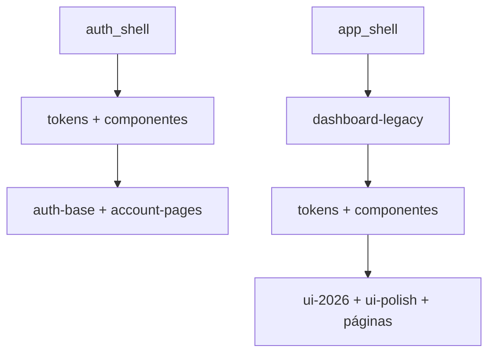

# Fase 4 · Limpieza frontend

## Objetivo

Reducir el acoplamiento visual entre autenticación y dashboard sin cambiar rutas,
permisos ni contratos de los formularios. La limpieza se hizo con una auditoría
estática de las plantillas y de los archivos de presentación antes de retirar
cualquier CSS.

## Resultado

### 1. Dos bases visuales explícitas

| Área | Plantilla base | Capas cargadas |
| --- | --- | --- |
| Autenticación y cuenta pública | `Principal/templates/auth_shell.html` | `design-tokens.css`, `components.css`, `auth-base.css`, `account-pages.css`, `notifications.css` |
| Dashboard autenticado | `Principal/templates/app_shell.html` | `dashboard-legacy.css`, tokens, componentes, capas `ui-2026*`, `ui-polish*`, portal, notificaciones y accesibilidad |

Las pantallas públicas ya no heredan `home.html`, `app_shell.html`,
Bootstrap ni el JavaScript del dashboard. El JavaScript de autenticación se
carga una sola vez desde `auth_shell.html`.

### 2. Plantillas actuales migradas

- `registration/login.html`
- `Registro.html`
- `registration/password_change_form.html`
- `registration/password_change_done.html`
- `verificacion_correo.html`

Todas usan `auth_shell.html`. Se conservaron los nombres de los campos,
acciones POST, tokens CSRF, URLs y formularios Django existentes. Los campos
de contraseña siguen usando el control de mostrar/ocultar y comparten
`components.css` y `account-pages.css`.

### 3. Capas CSS consolidadas

- `design-tokens.css` es la fuente única de colores, estados, tipografías,
  espacios, radios y sombras.
- `components.css` es la fuente única de botones compartidos, foco visible y
  utilidades accesibles. Los bloques duplicados de botones se retiraron de
  `ui-2026.css` y `ui-polish.css`.
- `auth-base.css` contiene únicamente la base pública de autenticación:
  cuerpo, shell principal, pie, verificación y utilidades del registro.
- `account-pages.css` conserva los componentes de cuenta (formulario, perfil,
  cambio de contraseña) y ahora puede funcionar tanto con `app_shell` como
  con `auth_shell`.
- `dashboard-legacy.css` encapsula los diez imports históricos del dashboard.
  `styles.css` queda como fachada de compatibilidad para plantillas antiguas.

## Referencias confirmadas

La auditoría recorrió 76 plantillas HTML y los archivos de presentación,
JavaScript y Python del árbol de la rama.

### Referencias actuales

- `app_shell.html` carga `dashboard-legacy.css`, tokens, componentes y
  las capas actuales del dashboard.
- `auth_shell.html` carga únicamente las capas públicas descritas arriba.
- `PerfilDeUsuarios.html` y `PerfilEditar.html` continúan en
  `app_shell.html` porque son vistas autenticadas de perfil y mantienen su
  integración con navegación y sesión.
- `account-pages.js` queda centralizado en `auth_shell.html`.

### Referencias heredadas conservadas

Estas referencias siguen existiendo en plantillas históricas y por eso no se
eliminaron:

| Archivo | Referencias heredadas |
| --- | --- |
| `styles.css` | `PerfilDeUsuario.html`, `PerfilDeUsuarioAdminAcademico.html`, `acudiente.html`, `admin_gestion_academica.html`, `admin_gestion_db.html`, `cordinador.html`, `docentes.html`, `editarPerfilDeUsuario.html`, `gestion_admin.html` |
| `register.css` | Las plantillas de registro/gestión históricas anteriores |
| `perfile.css` | Las tres plantillas de perfil históricas |
| `inicioDeSesiones.css` | `InicioSesion.html`, plantilla heredada no usada por el flujo actual |
| `legacy/01..10` | Se cargan mediante `dashboard-legacy.css` para el dashboard actual |

Mientras esas plantillas existan, retirar sus archivos rompería la
compatibilidad de renderizado. La siguiente fase puede retirar primero las
plantillas heredadas y después estos estilos con pruebas de regresión.

### CSS retirado tras validación

Se buscaron los nombres en plantillas, CSS, JavaScript y Python. No hubo
referencias para:

- `configuraciones.css`
- `logins.css`
- `registers.css`
- `registros.css`
- `test.css`

Los cinco archivos se eliminaron de esta rama después de confirmar que no
estaban importados ni enlazados.

## Flujo de cascada

El dashboard conserva sus capas visuales existentes, pero autenticación ya no
las descarga ni depende de sus selectores.

## Pendientes seguros

1. Convertir o retirar las plantillas históricas que todavía enlazan
   `styles.css`, `register.css`, `perfile.css` e
   `inicioDeSesiones.css`.
2. Tras esa conversión, repetir la misma auditoría y eliminar las fachadas y
   los imports de `legacy/` que ya no tengan consumidores.
3. Ejecutar la suite Django, PostgreSQL, cobertura, Playwright y la validación
   de CSS antes de fusionar esta fase.
